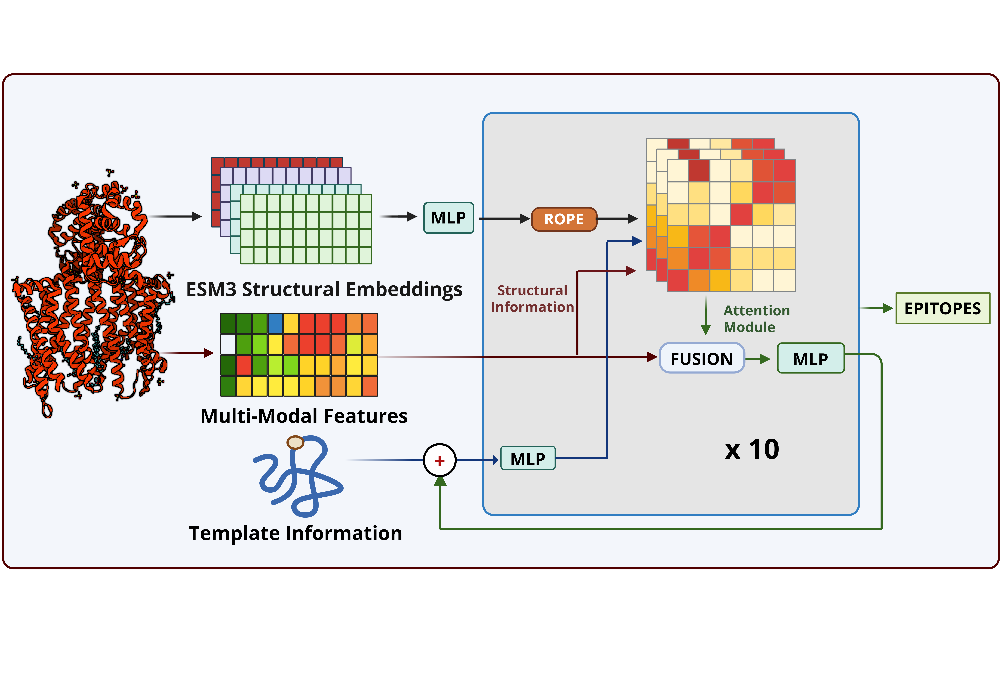

# 🧬 CARTnet: Contact-Aware Deep Learning for B-cell Epitope Prediction

CARTnet is a deep learning framework for residue-level conformational B-cell epitope prediction. It integrates protein structural embeddings, multimodal residue-level features, and intra-chain contact information through contact-aware attention blocks. The framework supports both template-free prediction and template-guided prediction using known epitope residues.

## 🏗️ Model Architecture



*Figure 1. Overview of the CARTnet framework for residue-level B-cell epitope prediction.*

## ⚙️ Installation

CARTnet was developed using Python 3.10 and PyTorch. CARTnet automatically uses a CUDA-enabled GPU when available and otherwise runs on CPU.
**1. Clone the repository**

```bash
git clone https://github.com/RajShekhorRoy/CARTnet.git
cd CARTnet
```

**2. Create and activate a Python environment**

```bash
python3.10 -m venv .venv
source .venv/bin/activate
```

**3. Install dependencies**

```bash
pip install -r requirements.txt
```
**4. Install DSSP**

CARTnet uses DSSP for structure-based feature generation. DSSP must be available on the system when CARTnet is run directly on the host machine.

On Debian/Ubuntu-based Linux systems:
```sudo apt-get update
sudo apt-get install dssp
```

Verify that DSSP is available:
```
mkdssp --version
```


If installing the required system dependencies locally is difficult, CARTnet can instead be run using Docker. The Docker image includes the required system dependencies, including DSSP.


## 💻 Usage

CARTnet supports template-free and template-guided epitope prediction from antigen structures in PDB format.

### Template-free Prediction

Run CARTnet without providing known epitope residues:

```bash
python main.py 
    --input_struc /path/to/antigen.pdb \
    --output_dir /path/to/output/
```

For example:

```bash
python main.py \
    --input_struc /home/rajroy/result_dump/test/8UDG_A.pdb \
    --output_dir /home/rajroy/result_dump/test/new_test_final/
```

### Template-guided Prediction

CARTnet also supports prediction using known epitope residues as templates. 

For current version template pdb structure is to be provided in the specific naming format.

The template-guided command will be added once the corresponding command-line arguments are specified.

Run CARTnet without providing known epitope residues:

```bash
python main.py \
    --input_struc /path/to/antigen.pdb \
    --output_dir /path/to/output/ \
    --template /path/to/complex_{anitbody_chains}{anigen_chains}.pdb
```

For example:

```bash
python main.py \
    --input_struc /home/rajroy/original/6W1C_H.pdb \
    --output_dir /home/rajroy/test/6W1C/ \
    --template_struc /home/rajroy/test/6VYV_PLH.pdb
```


## 🐳 Docker
Docker is recommended as a fallback when local installation is difficult. Docker must be installed before using the containerized version of CARTnet. See the official Docker installation guide for installation instructions.
```
⚠️ Memory requirement: Allocate at least 16 GB of memory to Docker. CARTnet uses ESM3 for feature generation, which requires substantial memory.
```
### Build the Docker image
Docker must first be installed on the host system. From the CARTnet repository directory, build the image with:
```
docker build -t cartnet:latest .
```
Run CARTnet with Docker
```
docker run --rm \
    -v /path/to/input_directory:/input:ro \
    -v /path/to/output_directory:/output \
    cartnet:latest \
    --input_struc /input/antigen.pdb \
    --output_dir /output/results/
```
For example, suppose the input structure is located at:

```
/home/user/proteins/8UDG_A.pdb
```
and results should be written under:
```
/home/user/cartnet_results/
```

Run:
```
docker run --rm \
    -v /home/user/proteins:/input:ro \
    -v /home/user/cartnet_results:/output \
    cartnet:latest \
    --input_struc /input/8UDG_A.pdb \
    --output_dir /output/8UDG_A/
```
The generated files will be available on the host at:
```
/home/user/cartnet_results/8UDG_A/
```
### Docker Network Troubleshooting

ESM3 model files may be downloaded from Hugging Face during the initial run, so the container requires internet access when the model is not already cached.

If Docker on Linux reports a DNS error such as:

Temporary failure in name resolution

try using host networking:
```
docker run --rm \
    --network=host \
    -v /path/to/input_directory:/input:ro \
    -v /path/to/output_directory:/output \
    cartnet:latest \
    --input_struc /input/antigen.pdb \
    --output_dir /output/results/

--network=host is a troubleshooting option and is not normally required.
```


## 📖 Citation

If you use CARTnet in your research, please cite the associated publication.

*Citation information will be updated upon publication.*